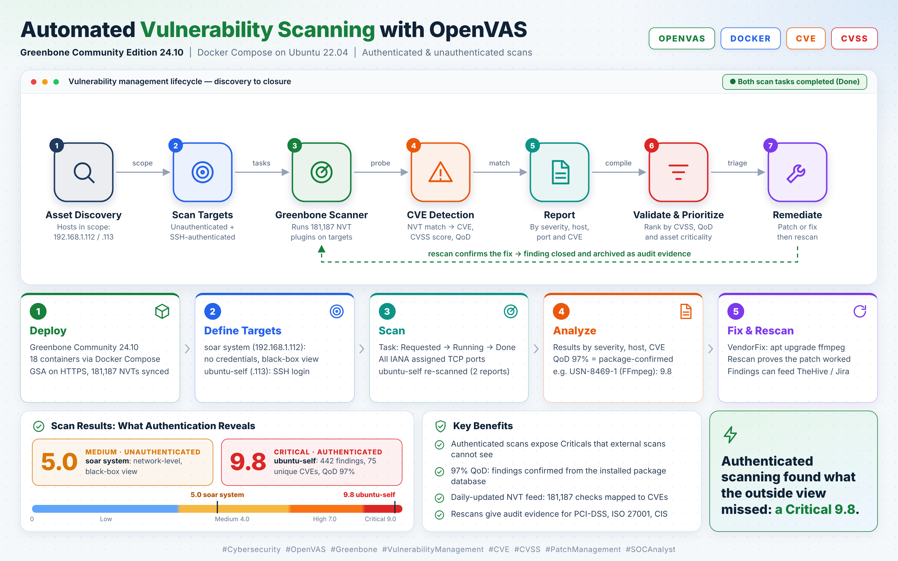

# Greenbone OpenVAS Vulnerability Management Lab


A hands-on vulnerability management lab built on the Greenbone Community Edition (OpenVAS),
deployed with Docker Compose. It documents the full workflow from deployment to scanning,
analysis, reporting and remediation, from a security operations (SOC) perspective.



## Table of Contents

- [Highlights](#highlights)
- [Architecture](#architecture)
- [Technology Stack](#technology-stack)
- [Components](#components)
- [Quick Start](#quick-start)
- [Scanning Workflow](#scanning-workflow)
- [Sample Results](#sample-results)
- [Use Cases](#use-cases)
- [Repository Structure](#repository-structure)
- [Security and Responsible Use](#security-and-responsible-use)
- [Roadmap](#roadmap)
- [License](#license)
- [Author](#author)

## Highlights

- Reproducible Docker Compose deployment of Greenbone Community Edition 24.10
- Authenticated (SSH) and unauthenticated scanning against lab targets
- Real scan report with severity breakdown (see [`reports/`](reports/))
- Written deployment guide covering targets, credentials, tasks and result analysis

## Architecture

```text
                    ┌──────────────────────────┐
                    │      Target Systems      │
                    │  Linux / Windows / VMs   │
                    └────────────┬─────────────┘
                                 │
                                 ▼
                    ┌──────────────────────────┐
                    │    Greenbone / OpenVAS   │
                    │   Vulnerability Scanner  │
                    └────────────┬─────────────┘
                                 │
                                 ▼
                    ┌──────────────────────────┐
                    │  Vulnerability Assessment│
                    └────────────┬─────────────┘
                                 │
                   ┌─────────────┴─────────────┐
                   ▼                           ▼
          ┌─────────────────┐         ┌─────────────────┐
          │  Scan Results   │         │  Vulnerability  │
          │   & Reports     │         │    Analysis     │
          └────────┬────────┘         └────────┬────────┘
                   └─────────────┬─────────────┘
                                 ▼
                    ┌──────────────────────────┐
                    │ Remediation & Security   │
                    │ Recommendations          │
                    └──────────────────────────┘
```

## Technology Stack

Greenbone Community Edition · OpenVAS Scanner · gvmd · gsad · PostgreSQL · Redis · Nginx · Docker · Docker Compose

## Components

| Component           | Purpose                                         |
| ------------------- | ----------------------------------------------- |
| OpenVAS Scanner     | Performs vulnerability scanning                 |
| `gvmd`              | Vulnerability management and scan orchestration |
| `gsad`              | Web/API interface                               |
| PostgreSQL          | Stores vulnerability management data            |
| Redis               | Scanner-related runtime communication           |
| Nginx               | Frontend / reverse proxy                        |
| Vulnerability Tests | Vulnerability test (VT) feed                    |
| SCAP Data           | Security Content Automation Protocol data       |
| CERT Data           | CERT and advisory information                   |
| Notus Data          | Local vulnerability detection data              |

## Quick Start

**Prerequisites:** a Linux host (tested on Ubuntu 22.04) with Docker Engine and the Docker Compose plugin.

```bash
git clone https://github.com/Pamidipallikiran/greenbone-openvas-lab.git
cd greenbone-openvas-lab/config
docker compose up -d
```

Then open `https://<host-ip>` in a browser. The first start downloads the vulnerability feeds,
which can take a long time. See [`config/README.md`](config/README.md) for setting the admin
password, stopping the stack and hardening notes, and the
[deployment guide](docs/deployment-guide.pdf) for the full walkthrough.

## Scanning Workflow

```text
Target Discovery → Target Configuration → Scan Configuration → Vulnerability Scan
      → Result Collection → Severity Analysis → Report Generation → Remediation
```

## Sample Results

Authenticated scan of the `ubuntu-self` host
([full report](reports/openvas-scan-report-ubuntu-self-2026-07.pdf)):

| Critical | High | Medium | Low |
| :------: | :--: | :----: | :-: |
|    1     |  10  |   6    |  3  |

Findings shown have a QoD of 70 or higher (20 results after filtering 442 raw results).

## Use Cases

- Vulnerability assessment of Linux and Windows systems
- Identification of critical and high-risk vulnerabilities
- Security baseline validation
- Remediation verification
- SOC vulnerability-management workflows

## Repository Structure

```text
greenbone-openvas-lab/
├── README.md
├── LICENSE
├── .gitignore
├── config/
│   ├── README.md              # how to run, stop and harden the stack
│   └── docker-compose.yml     # Greenbone Community Edition 24.10 stack
├── docs/
│   ├── README.md
│   ├── deployment-guide.pdf   # deployment and scanning walkthrough
│   ├── images/                # infographic and diagrams
│   └── screenshots/           # GSA interface screenshots
└── reports/
    ├── README.md
    └── openvas-scan-report-ubuntu-self-2026-07.pdf
```

## Security and Responsible Use

- Only scan systems you own or have **explicit written permission** to test.
- This repository intentionally excludes database contents, feed data, logs, private keys,
  credentials, API tokens, TLS secrets and persistent Docker volumes (see `.gitignore`).
- IP addresses in the documents are private lab addresses (RFC 1918).
- Review and sanitize the configuration before reusing it in another environment.

## Roadmap

- [x] Deployment documentation
- [x] Sample vulnerability report
- [ ] Target configuration examples
- [ ] Authenticated-scan documentation (Windows and Linux)
- [ ] Vulnerability remediation workflow
- [ ] Wazuh / SOAR integration
- [ ] Automated deployment validation

## License

Released under the [MIT License](LICENSE).

## Author

**Kiran Pamidipalli**
Cybersecurity | SOC | Vulnerability Management | Network Security
